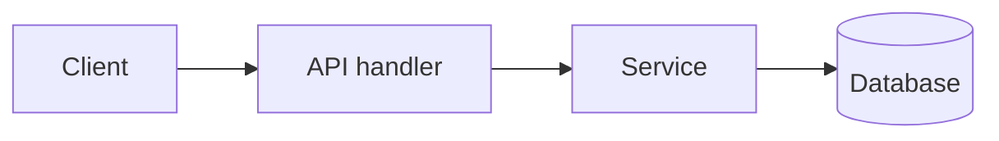
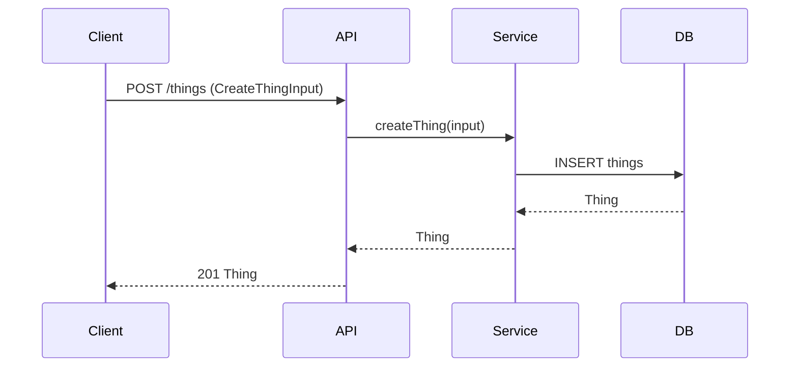

# Design: <feature name>

| | |
|---|---|
| **Status** | Draft / In review / Approved (YYYY-MM-DD) / Implemented (YYYY-MM-DD) |
| **Author** | <agent> for <user> |
| **Date** | YYYY-MM-DD |
| **Reviewers** | |
| **Related** | issue / ticket / plan link / PR |

## 1. Summary

Three to five sentences: the problem, the proposed solution, and the main trade-off. A reader who stops here should know what is being built.

## 2. Background and problem

Current state of the system, what is missing or wrong, and who is affected. Cite the code paths involved.

## 3. Requirements

### Functional

| ID | Requirement | Source |
|---|---|---|
| R1 | | user request / issue #123 |
| R2 | | |

### Non-functional

| ID | Requirement | Target |
|---|---|---|
| N1 | Latency | p95 < X ms for ... |
| N2 | Scale | up to N items / M requests per second |
| N3 | Consistency / durability | |
| N4 | Security / privacy | |
| N5 | Compatibility | |
| N6 | Observability | |

### Goals and non-goals

- Goals: ...
- Non-goals: ...

### Assumptions

- A1: ...

## 4. Proposed design

### 4.1 Overview

Short description of the approach and a component diagram.



### 4.2 Components

| Component | Responsibility | Location (new / existing file) |
|---|---|---|
| | | |

## 5. Data model

Every data structure the feature creates, changes, or reads. One subsection per structure; see `data-structure-catalog.md` for the required fields.

### 5.1 `<StructureName>` (new / changed / read-only)

- **Kind:** class / interface / table / document / enum / event / cache entry
- **Defined in:** `path/to/file.ext` or schema/migration name
- **Purpose:**
- **Lifecycle:** created by ..., mutated by ..., deleted by ...
- **Persistence / transport:** table X, Redis key pattern `...`, Kafka topic `...`, in-memory only
- **Expected size:** rows / bytes / items, growth per day

| Field | Type | Nullable | Description | Constraints / index |
|---|---|---|---|---|
| id | uuid | no | primary key | PK |
| | | | | |

- **Invariants:** rules that must always hold (e.g. `end >= start`, unique per user).
- **Relationships:** foreign keys, ownership, cascade behaviour.

### 5.2 Schema migrations

Ordered list of migrations with DDL or ORM migration steps, backfill strategy, and whether each is backward compatible with the currently deployed code.

### 5.3 Data structure summary

| Structure | Kind | New/Changed/Read | Defined in | Persisted in |
|---|---|---|---|---|
| | | | | |

## 6. Interfaces and APIs

### 6.1 Internal interfaces

```ts
// exact signatures the implementation must provide
function createThing(input: CreateThingInput): Promise<Thing>
```

### 6.2 External API

| Method | Path | Request | Response | Errors |
|---|---|---|---|---|
| POST | /api/things | `CreateThingInput` | `201 Thing` | 400 validation, 409 duplicate |

### 6.3 Events / messages

| Topic / queue | Payload | Producer | Consumers |
|---|---|---|---|

### 6.4 Compatibility

What existing callers see; versioning or deprecation steps.

## 7. Algorithms and complexity

For every non-trivial operation.

### 7.1 `<operation name>`

Pseudocode or numbered steps.

| Measure | Value | Notes |
|---|---|---|
| Time complexity | O(n log n), n = number of ... | |
| Space complexity | O(n) | |
| Expected n | ~10k today, 100k in a year | |
| Database queries | 2 (indexed on `user_id, created_at`) | no N+1 |
| Hot path? | yes / no | |

### 7.2 Complexity summary

| Operation | Time | Space | Dominant cost |
|---|---|---|---|

## 8. Data flow



Describe the failure paths: what happens on validation errors, partial failures, retries, timeouts.

## 9. Error handling

| Failure | Detection | Behaviour | User-visible result |
|---|---|---|---|

## 10. Security and privacy

Authentication, authorization, input validation, data classification, PII handling, audit logging, secrets.

## 11. Performance and scalability

Expected load, bottlenecks, caching, indexes, pagination, backpressure, limits. Link each item to the complexity table.

## 12. Observability

Logs, metrics, traces, alerts to add.

## 13. Testing strategy

| Behaviour / requirement | Level | Test location | Notes |
|---|---|---|---|
| R1 | unit | `tests/...` | |
| N1 | performance | | |

## 14. Rollout and migration

Flags, deploy order, backfill, rollback, data created during partial rollout.

## 15. Alternatives considered

| Alternative | Summary | Why not chosen |
|---|---|---|

## 16. Open questions

| # | Question | Owner | Blocking? |
|---|---|---|---|

## 17. Implementation plan

Link to the plan from `plan-feature`, or an ordered list of steps.

## 18. Glossary

| Term | Meaning |
|---|---|

## 19. Revision history

| Date | Change | By |
|---|---|---|

## 20. Implementation notes (filled after approval)

- Final locations of each data structure and interface (table mapping design name to file path).
- Deviations from the approved design and why.
- Measured performance, if any.
