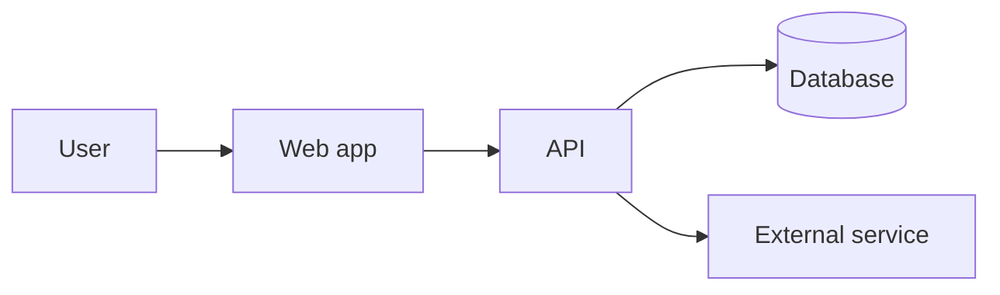
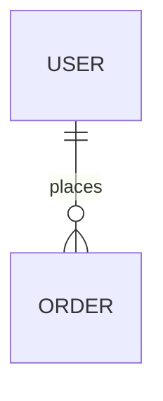

# Project design: <project name>

| | |
|---|---|
| **Status** | Draft / In review / Approved (YYYY-MM-DD) |
| **Owner** | <user> |
| **Last updated** | YYYY-MM-DD |
| **Scope** | Whole repository / these apps and services: ... |

> Once approved, the **Guidelines** in section 9 are binding for every feature design, plan, implementation and review. Changing them requires an approved amendment (section 13).

## 1. Purpose and product overview

What the product does, for whom, and the outcomes that matter. Three to six sentences.

## 2. Goals, non-goals and constraints

- **Goals:** ...
- **Non-goals:** ...
- **Constraints:** hosting, budget, compliance (GDPR, HIPAA, PCI), team skills, deadlines, platform requirements.
- **Assumptions:** ...

## 3. System context

Users, external systems and integrations, and the boundary of this system.



## 4. Architecture

### 4.1 Components

| Component | Responsibility | Location | Owns data |
|---|---|---|---|
| | | `apps/...` | |

### 4.2 Architectural style and rules

Layering, module boundaries, allowed dependencies between modules (what may import what), sync vs async communication, where business logic lives.

### 4.3 Repository and folder structure

```
apps/
  web/        # ...
  backend/    # ...
packages/
```

Where new code of each kind goes (routes, services, components, jobs, tests).

## 5. Technology stack

| Concern | Choice and version | Why | Alternatives rejected |
|---|---|---|---|
| Language | | | |
| Framework | | | |
| Database | | | |
| ORM / data access | | | |
| Cache / queue | | | |
| Auth | | | |
| Hosting / CI | | | |

## 6. Core domain model

Entities shared across features. Feature designs reference these instead of redefining them. Use the data-structure catalogue format for each.

| Entity | Kind | Defined in | Store | Owner module | Key invariants |
|---|---|---|---|---|---|
| User | table + type | `prisma/schema.prisma`, `src/types/user.ts` | Postgres `users` | auth | email unique, soft delete only |

Relationships diagram (optional):



### 6.1 Data ownership and access

Which module is allowed to write each store; how others read it (API, events, read replicas). No cross-module writes unless listed here.

## 7. Cross-cutting conventions

| Concern | Convention |
|---|---|
| API style | REST/GraphQL/RPC, URL and naming rules, versioning |
| Request validation | library, where it runs |
| Error format | shape of error responses and error classes |
| Pagination, filtering, sorting | cursor/offset, limits |
| Authentication and authorization | mechanism, where checks live |
| Transactions and consistency | |
| Background jobs and events | |
| Configuration and secrets | |
| Logging, metrics, tracing | |
| Internationalization, time zones, money | |
| Frontend state and data fetching | |

## 8. Quality attributes and budgets

| Attribute | Target |
|---|---|
| Latency | p95 < ... ms for ... |
| Scale | users, requests/s, data volume, growth |
| Availability | |
| Security and privacy | data classification, PII handling |
| **Complexity budgets** | e.g. no O(n²) on request paths for collections that can exceed 1 000 items; every list query is indexed and paginated; no N+1 queries |
| Accessibility | |

## 9. Guidelines (binding once approved)

Numbered, testable rules. Each feature design lists the ones it applies and how it complies.

### G1 – <short title>

- **Rule:** precise, checkable statement.
- **Rationale:** why.
- **Applies to:** modules, layers or kinds of change.
- **Example:** compliant snippet or reference to existing code.
- **How it is checked:** lint rule, test, review checklist item.

### G2 – ...

## 10. Testing strategy

Levels (unit, integration, end-to-end), tools, where tests live, what must be tested for every feature, test data, coverage expectations.

## 11. Delivery

Branching and review, CI checks, environments, deployment, migrations policy, feature flags, rollback.

## 12. Feature index

Every feature design and plan, kept current.

| Feature | Design doc | Plan | Status | Guidelines touched |
|---|---|---|---|---|
| | `docs/design/...` | `docs/plans/...` | Approved / Implemented | G2, G5 |

## 13. Decision log and amendments

| Date | Decision / amendment | Guidelines affected | Reason | Approved by |
|---|---|---|---|---|

## 14. Risks and open questions

| # | Item | Impact | Owner |
|---|---|---|---|

## 15. Glossary

| Term | Meaning |
|---|---|

## 16. Revision history

| Date | Change | By |
|---|---|---|
